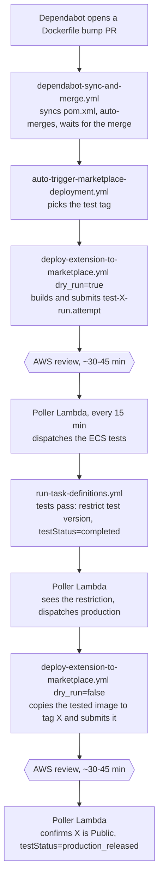

# 📦 Liquibase AWS Marketplace Release Process

This repo ships the Liquibase Secure Docker image, with the AWS License Service
extension installed, to AWS Marketplace listing `prod-l2panlvbozc5e` in the
`LiquibaseAWSMP` account (us-east-1). A new Secure release reaches the listing
in about two hours with no manual steps.

## 🗺️ Release flow



Production publishes the image that passed the tests, copied by digest, and never
rebuilds it. Marketplace version titles can only be used once, so a bad public
version cannot be replaced under the same name.

## ⚙️ Workflows

| Workflow | Trigger | What it does |
|---|---|---|
| `dependabot-sync-and-merge.yml` | Dependabot PR touching `Dockerfile`/`pom.xml` | Syncs `liquibase-secure.version` and `amazon.aws.version` in `pom.xml` to the Dockerfile, arms auto-merge, waits up to 30 min for the merge, then dispatches the auto-trigger |
| `auto-trigger-marketplace-deployment.yml` | Dispatch from the sync workflow, or a push to `main` changing `Dockerfile`/`pom.xml` | Detects the version change and dispatches a dry run with a `test-` tag |
| `deploy-extension-to-marketplace.yml` | Dispatch only | `dry_run=true`: builds, pushes and submits a `test-`/`qa-` image. `dry_run=false`: publishes `tested_image_tag` as the Dockerfile version (see below) |
| `run-task-definitions.yml` | Dispatch from the poller | Runs the ECS test tasks on `aws-mp-test-cluster`; on success restricts the test version and sets `testStatus=completed` |
| `deploy-marketplace-poller-lambda.yml` | PR or push to `main` touching `lambda/marketplace-poller/**` | Tests the poller, and on `main` deploys it to `PollMarketplaceChangeSetStatus` |
| `marketplace-release-watchdog.yml` | Every 2 hours | Fails when a release has been stuck in one state for more than `stall_hours` (default 2) |
| `sync-amazon-aws-version.yml` | Daily | Opens a PR when `amazon.aws.version` drifts from the AWS SDK in the current Secure release |

Notes:

- `com.liquibase:liquibase-commercial` is ignored in `dependabot.yml` and synced from the Dockerfile instead, so a bump is always one self-consistent PR.
- The sync workflow waits for the merge because everything downstream reads `main`; do not remove the wait.

### 🚢 Production publish (`dry_run=false`)

The poller dispatches it with `validated_version` and `tested_image_tag`. Before
publishing, the job refuses when:

- `validated_version` is not the Dockerfile version on `main`
- `tested_image_tag` is not a `test-` tag of that version
- the tag's DynamoDB row is not `completed`, `production_dispatched` or `production_released`
- the test version is not `Restricted` on the listing

It then copies the tested image to the version tag with
`skopeo copy --all --preserve-digests` and checks the digest. It skips the
submit when the version is already on the listing, so a re-run is safe.

## 🔁 Poller Lambda

`PollMarketplaceChangeSetStatus` runs every 15 minutes from EventBridge. Source:
[`lambda/marketplace-poller/`](../lambda/marketplace-poller/). Terraform owns its
configuration and CI owns its code, so do not edit it in the console.

Each run:

1. Finds `SUCCEEDED` change sets from the last `LOOKBACK_DAYS` (default 7) for versions titled `test-*`, and dispatches the ECS tests.
2. For `completed` rows, finds the `RestrictDeliveryOptions` change set for that version's delivery options. When it has `SUCCEEDED`, it dispatches production and sets `production_dispatched`.
3. Sets `production_released` once the version is Public on the listing.

Only titles **starting with** `test-` are automated. `qa-` and hand-made titles
such as `devopstest-5.2.2` are ignored and must be restricted by hand.

## 🏷️ Test tags

| Tag | Version released |
|---|---|
| `test-5.2.3-482.1` | `5.2.3` (run 482, attempt 1) |
| `test-5.2.3-482.2` | `5.2.3` (retry of the same run) |
| `test-5.2.2-beta-482.1` | `5.2.2-beta` |
| `test-5.2.2` | `5.2.2` (older format) |

## 📊 Release states

Table `liquibase-secure-marketplace-changesets`, field `testStatus`:

| State | Meaning | Watchdog alerts after |
|---|---|---|
| `testing` | ECS tests dispatched | 2h from `createdDate` |
| `completed` | Tests passed, waiting on the restriction | 2h from `testCompletedAt` |
| `on_hold` | Paused by hand; nothing reads it | never |
| `production_dispatched` | Production run dispatched, not yet Public | 2h from `productionTriggeredAt` |
| `production_released` | Public on the listing | never |
| `abandoned` | Will never release; use instead of deleting the row | never |

The watchdog also flags `test-*` versions that are still Public but were never
tracked, which happens when the poller is down longer than `LOOKBACK_DAYS`.

## 🔍 If a release does not appear

1. Open the latest `marketplace-release-watchdog.yml` run.
2. Read the poller logs: log group `/aws/lambda/PollMarketplaceChangeSetStatus`.
   - `No restriction change set found yet for <tag>` on repeat: the restriction lookup is not matching.
   - `Failed to trigger workflow: ... 422`: GitHub rejected the dispatch, usually a required input the poller does not send.
3. List the latest change sets:
   ```bash
   aws marketplace-catalog list-change-sets --catalog AWSMarketplace --region us-east-1 \
     --filter-list '[{"Name":"EntityId","ValueList":["prod-l2panlvbozc5e"]}]' \
     --sort '{"SortBy":"StartTime","SortOrder":"DESCENDING"}' --max-results 5
   ```
   AWS rejects a change set while another is in flight on the same product.
4. In a production run, look for `✅ <version> is the tested image sha256:…`.

## 🧪 Manual testing

### ▶️ ECS tasks on the marketplace image

Ask DevOps for access to the `LiquibaseAWSMP` account. Task definitions live in
[`.github/task-definitions/`](../.github/task-definitions/) and run on the
`aws-mp-test-cluster` Fargate cluster.

```bash
aws ecs run-task --cluster aws-mp-test-cluster --task-definition update-liquibase
```

From the console: **Tasks**, **Run new task**, pick the **Family**, then **Create**.
Logs are on the task's **Logs** tab.


### 🛠️ QA dry run

To put a build on the listing without releasing it, run
`deploy-extension-to-marketplace.yml` with `dry_run=true` and
`image_tag=qa-<version>-<n>`. Restrict the version by hand once AWS approves it.
Never use a `test-` tag for this: the poller would test it and release the version.

### 🐳 Local image

The image is `liquibase/liquibase-secure` plus the extension installed with `lpm`,
and sets `DOCKER_AWS_LIQUIBASE=true`.

```bash
docker build -t liquibase-aws-license-service .
docker run --rm liquibase-aws-license-service liquibase --version   # lists liquibase-aws-license-service-X.Y.Z.jar
docker run --rm liquibase-aws-license-service ls -la /liquibase/lib/
```

## ✨ Releasing the extension itself

The `liquibase-aws-license-service` extension is released only when needed. After
a release, Dependabot opens a PR in
[liquibase-package-manager](https://github.com/liquibase/liquibase-package-manager);
review and merge it by hand so `lpm` can install the new version.
